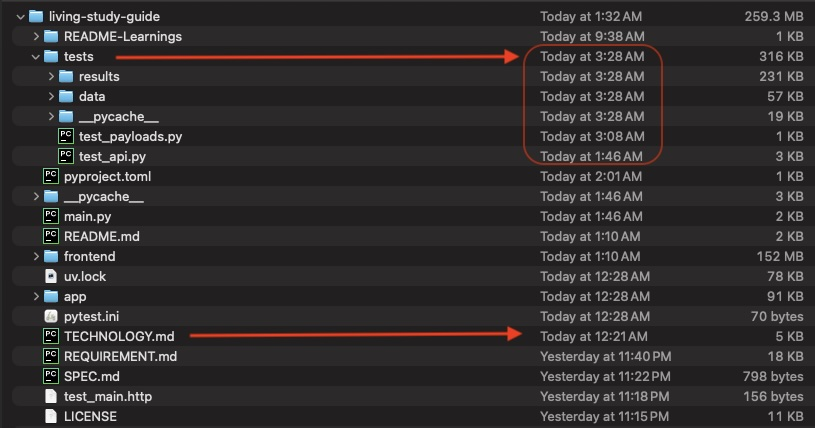

1. Copy Requirements from Handshake.ai --> SPEC.md
2. Goose.ai and QWEN3.6:35b read SPEC.md to create requirements --> REQUIREMENTS.MD
3. List Technology to be used in this project --> TECHNOLOGY.MD
4. Ask Junie.ai to read TECHNOLOGY.md and add to it
   > Recommend other python packages to use in this project based on the contents of REQUIREMENT.md and SPEC.md.  Append Results back to TECHNOLOGY.MD

5. Ask Junie to build (Gemini 3.7 Flash - Low effort)
6. > Based on the contents of REQUIREMENT.md, SPEC.md, using the technological guidelines in TECHNOLOGY.md, build out this application.  Postgressql database is running in Colima in a container for database creation.

7. Ask Goose.AI locally: 
> Based on the contents of REQUIREMENT.md, SPEC.md, using the technological guidelines in TECHNOLOGY.md, 
> a. validate the built application for correctness.
> b. generate test mock payload to execute all the API and save them to folder tests/data.
###  (12:21 am to 3:28 am )

.
.

### ---- The above tests did all this below ---
#### (Unnecessary)
8.Ask Goose.AI to execute:
> Execute the `living-study-guide` python application. Provide a url in the terminal response i can click in the browser and run.
